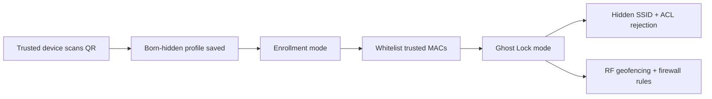

# PhantomAP

<p align="center">
  
  
  
</p>

PhantomAP is a Zero-Visibility Wi‑Fi and hotspot cloaking suite for Linux hosts and controlled home-router environments.

It lets you start a hidden AP in enrollment mode, generate a QR code carrying the hidden Wi‑Fi profile (`H:true`), and then switch into Ghost Lock Mode to suppress unauthorized probes and authentication attempts.

## Why PhantomAP

Most hotspot tools expose the SSID too early and leak beacon or probe information. PhantomAP is designed for a safer flow:

- Born-hidden enrollment using a QR code with `H:true`
- Hidden SSID startup in enrollment mode
- Ghost Lock mode using MAC allowlists and ACL enforcement
- Optional RF-geofencing to keep signal leakage near the room
- Safe fallback behavior when AP features are unavailable on Windows hosts

## Supported flow



## Linux-first behavior

PhantomAP is built primarily for Linux because real AP management requires these OS components:

- hostapd
- dnsmasq
- iproute2
- iw
- iptables or nftables

On Windows, the tool does not attempt to falsely claim AP support. Instead it safely falls back to generating the hidden QR profile and exits with a clear warning when AP launching is unavailable.

## Quick start

### 1) Install dependencies

```bash
python -m pip install -r requirements.txt
```

### 2) Linux AP startup with hidden QR

```bash
python -m phantom_ap.cli start --ap --qr --ssid PhantomAP --passphrase secretpass
```

### 3) Lock the AP after enrollment

```bash
python -m phantom_ap.cli lock --iface wlan0 --whitelist AA:BB:CC:DD:EE:FF
```

### 4) Stop and restore

```bash
python -m phantom_ap.cli stop --iface wlan0
```

## Command reference

```bash
python -m phantom_ap.cli --help
python -m phantom_ap.cli start --ap --qr --ssid PhantomAP --passphrase secretpass
python -m phantom_ap.cli qr --ssid PhantomAP --passphrase secretpass
python -m phantom_ap.cli lock --iface wlan0 --whitelist AA:BB:CC:DD:EE:FF
python -m phantom_ap.cli stop --iface wlan0
```

## Repository structure

```text
phantom-ap/
├── README.md
├── LICENSE
├── pyproject.toml
├── requirements.txt
├── install.sh
├── .gitignore
├── .github/
│   └── workflows/
│       └── ci.yml
├── patches/
│   ├── build_stealth_hostapd.sh
│   └── zero_beacon_hostapd.patch
├── src/
│   └── phantom_ap/
│       ├── __init__.py
│       ├── __main__.py
│       ├── cli.py
│       ├── tui.py
│       ├── config.py
│       ├── engines/
│       │   ├── __init__.py
│       │   ├── pc_hotspot.py
│       │   └── router_bridge.py
│       ├── security/
│       │   ├── __init__.py
│       │   ├── qr_enroll.py
│       │   ├── rf_geofence.py
│       │   └── wids_monitor.py
│       └── network/
│           ├── __init__.py
│           ├── firewall.py
│           └── anonymizer.py
├── tests/
│   └── test_hwsim_sandbox.py
└── install.sh
```

## Security and legal notice

This project is intended for authorized wireless testing, controlled home-network deployment, and legitimate security research on networks you own or are explicitly authorized to test.

Do not use it to interfere with third-party Wi‑Fi networks or violate local laws.

## Development and verification

```bash
pytest -q
```

The repository includes a Linux `mac80211_hwsim` validation path so it can be tested in CI without physical radio hardware.

## License

This project is released under the MIT License.
